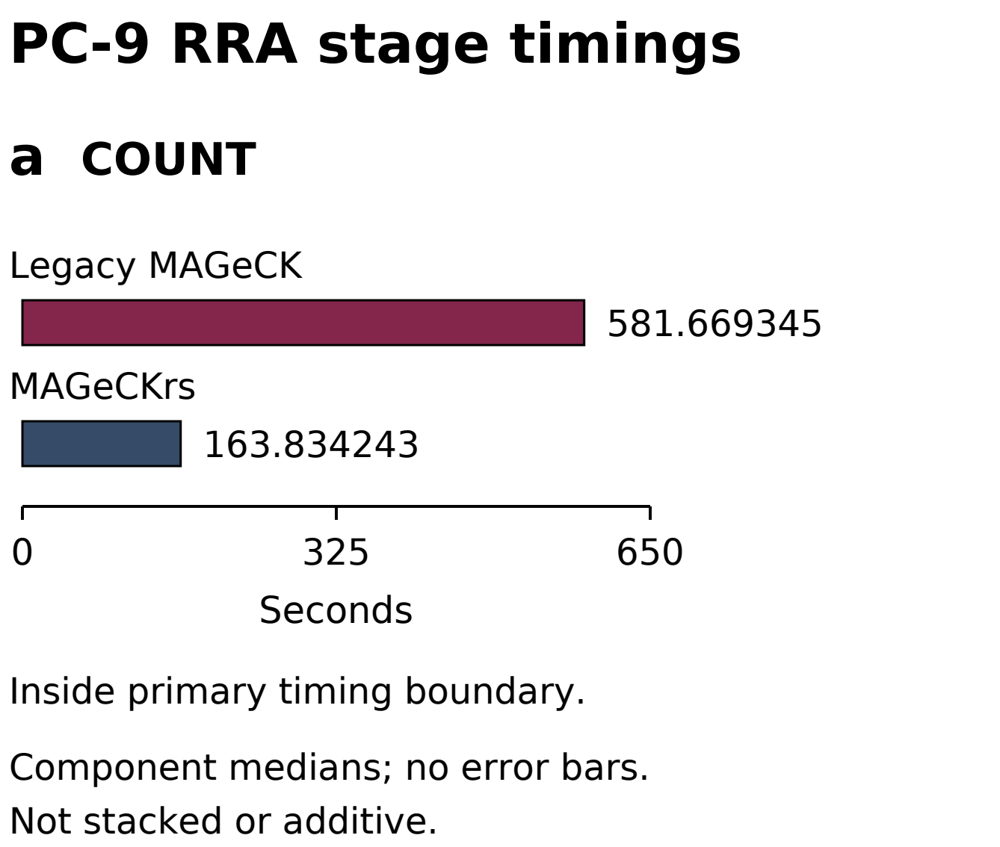

# MAGeCKrs

Rust workflows for guide counting and gene-level analysis of pooled CRISPR screens.

**MAGeCKrs 0.1.0 is a source-only release for Apple Silicon macOS.**
Build the executable locally.
No compiled executable or application is distributed.
[Current release: v0.1.0](https://github.com/Yoonecorn/MAGeCKrs/releases/tag/v0.1.0).

## Documentation

- [MAGeCKrs Manuscript](docs/MAGeCKrs_Manuscript.pdf): manuscript and complete Supplementary Information.
- [MAGeCKrs User Manual](docs/MAGeCKrs_User_Manual.pdf): complete workflows, command reference, and linked instructions.
- [Synthetic examples](examples/campaign-a/README.md): small inputs and expected counts.
- [Numerical contract](docs/numerical-contract.md): fitting and inference acceptance rules.

## What MAGeCKrs does

- Counts guides from plain or gzip FASTQ with explicit sample grouping.
- Supports fixed offsets, automatic exact-match trimming, and unique one-mismatch matching at fixed offsets.
- Counts exact guide-UMI keys with an explicit deduplication scope.
- Writes unmatched FASTQ records on request.
- Runs RRA comparisons and classical MLE with ordinary Wald inference.
- Joins COUNT and RRA in `run`.
- Applies an optional post-MLE CNV beta adapter.

| Interface | Main input and result |
|---|---|
| `count` | Library and FASTQ groups to raw counts and QC. |
| `test` | Count table and sample roles to directional RRA summaries. |
| `run` | COUNT then RRA from raw counts in one workflow. |
| `mle` | Count table and design matrix to coefficients and ordinary Wald results. |
| UMI / unmapped / CNV options | Explicit opt-in interfaces described in the manual. |


## Performance overview

These observations describe the tested datasets, hardware, and configurations.
Read the PC-9 RRA stage context first, then the separate complete-workflow comparisons.

The complete benchmark methods, scientific comparisons, and interpretation limits are available in the [MAGeCKrs Manuscript](docs/MAGeCKrs_Manuscript.pdf).

**PC-9 RRA COUNT-stage context**



*Figure S1a.* PC-9 RRA COUNT-stage component medians are **581.669345 s for Legacy MAGeCK** and **163.834243 s for MAGeCKrs**.
COUNT is inside the primary timing boundary.
These component summaries are not stacked or additive, and this is not a complete-workflow comparison.

**Complete-workflow runtimes**


*Figure 2a-c.* Median runtimes below compare **Legacy MAGeCK with MAGeCKrs**, in that order.
Runtime ratios use Legacy MAGeCK divided by MAGeCKrs.

- **a. Complete PC-9 RRA:** 623.096344 s versus 165.108136 s; observed median paired runtime ratio **3.769137010** from **three fresh pairs**.
- **b. Complete PC-9 MLE:** 241.969656 s versus 65.914413 s; observed ratio of engine medians **3.670967319**, with **six observations per engine**.
- **c. Complete HCC827 MLE:** 237.9524685 s versus 65.109550 s; observed ratio of engine medians **3.654647721**, with **six observations per engine**.

Upper whiskers extend from the median to the observed maximum.
They are descriptive ranges, not confidence intervals.
The benchmark campaigns are not pooled.
**HCC827 showed high aggregate agreement, but selected scientific outputs differed.**
These runtime observations do not establish universal speedups, timing significance, or identical RRA or MLE scientific outputs.
See the [user manual](docs/MAGeCKrs_User_Manual.pdf) for workflow instructions and interpretation limits.

## Important limits

COUNT remains serial under all worker policies.
RRA, run analysis, and MLE support CPU worker limits.
RRA significance values are nominal rank-model diagnostics, not a universal biological false-discovery guarantee.
MLE permutation-style columns remain 1.0 placeholders.
CNV adjusts matched betas without recomputing uncertainty or significance.
Numerical convergence does not prove biological truth.
UMI and CNV interfaces carry no biological-accuracy guarantee.

Pathway/GSEA, MLE permutation inference, supplied MLE seeds, and operational Metal/GPU execution are deferred.
Linux, Windows, Intel Mac, and universal binaries are unsupported.
See the [manual's scope and interpretation sections](docs/MAGeCKrs_User_Manual.pdf).

## Requirements

Use an Apple Silicon Mac with Git, Rust/Cargo, and Apple command-line developer tools.
Rust 1.98.0 is the validated toolchain.
The declared minimum Rust version has not been independently qualified.
Builds link dynamically to macOS system and Accelerate libraries.
Building from source does not require an Apple Developer ID.

## Installation

Clone the fixed software release into a new directory.
Build with the locked dependencies.
Set the executable path.

<!-- command: readme-install -->
```sh
git clone --branch v0.1.0 --depth 1 \
  https://github.com/Yoonecorn/MAGeCKrs.git mageckrs
cd mageckrs
cargo build --release --locked
BIN="${CARGO_TARGET_DIR:-target}/aarch64-apple-darwin/release/mageckrs"
"$BIN" --version
```

The default executable is `target/aarch64-apple-darwin/release/mageckrs`.
An explicit `CARGO_TARGET_DIR` changes the leading directory.
Use Git to obtain the source from the repository.

## Quick start

Run from the cloned repository root in the same shell.
Use a fresh output directory.
The included inputs are synthetic.

<!-- command: readme-count -->
```sh
OUT=$(mktemp -d)
"$BIN" count -l examples/campaign-c/library.tsv \
  -f examples/campaign-c/day0.fastq \
     examples/campaign-c/treat-a.fastq \
     examples/campaign-c/treat-b.fastq \
  --sample-label Day0,TreatA,TreatB --norm-method none \
  -n "$OUT/screen"
head -n 3 "$OUT/screen.count.txt"
```

Expected first rows:

```tsv
sgRNA	Gene	Day0	TreatA	TreatB
g0_0	G0	100	0	90
g0_1	G0	113	0	97
```

COUNT also writes normalized counts, physical-read QC, and run information.
Use the [complete manual](docs/MAGeCKrs_User_Manual.pdf) for RRA, MLE, combined run, UMI, unmapped output, and CNV examples.
Use fresh prefixes for all workflows.
Ordinary COUNT can overwrite earlier files.

## Validation status

The version 0.1.0 public source passes 1,088 all-target tests, two separately invoked end-to-end tests, and one doctest on the tested Apple Silicon macOS host.
Formatting, all-target checks, and Clippy with warnings as errors also pass.
These checks establish bounded interface and numerical behavior.
They do not establish universal biological accuracy, clean-machine installation, or other-platform support.
The public suite uses synthetic and permitted support fixtures.

## Citation

Yap, Yoon Sing. *MAGeCKrs*, version 0.1.0. GitHub repository, 2026.
See [CITATION.cff](CITATION.cff) and the [source release](https://github.com/Yoonecorn/MAGeCKrs/releases/tag/v0.1.0).
No DOI or preprint deposition is asserted.

## License and support

Copyright (c) 2026 Yoon Sing Yap.
Licensed under [MIT](LICENSE).
[Third-party notices](THIRD_PARTY_NOTICES.md) preserve upstream terms and documented discrepancies.
Use [GitHub Issues](https://github.com/Yoonecorn/MAGeCKrs/issues) for questions and bug reports.
