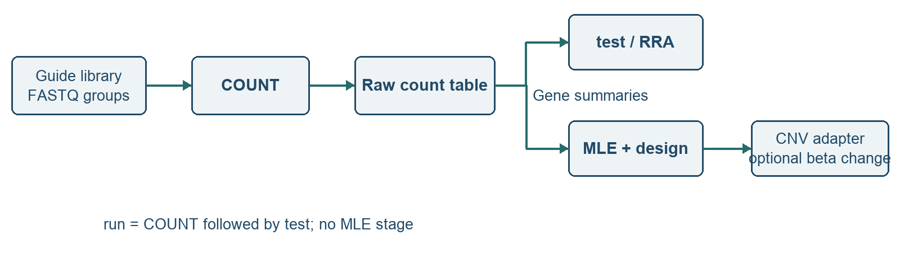

# MAGeCKrs User Manual

**Software version:** 0.1.0

**Document date:** 23 October 2026

**Author:** Yoon Sing Yap

**Release scope:** source only; Apple Silicon macOS

[Repository](https://github.com/Yoonecorn/MAGeCKrs) | [Release v0.1.0](https://github.com/Yoonecorn/MAGeCKrs/releases/tag/v0.1.0) | [PDF edition](MAGeCKrs_User_Manual.pdf) | [README](../README.md)

## Contents

- [Release scope](#release-scope)
- [Introduction](#introduction)
- [Platform and prerequisites](#platform-and-prerequisites)
- [Install from source](#install-from-source)
- [Verify the build](#verify-the-build)
- [Command overview](#command-overview)
- [Input-file formats](#input-file-formats)
- [Guide-library format](#guide-library-format)
- [FASTQ grouping](#fastq-grouping)
- [COUNT](#count)
- [Trimming and matching](#trimming-and-matching)
- [Exact UMI counting](#exact-umi-counting)
- [Unmapped-read output](#unmapped-read-output)
- [RRA with test](#rra-with-test)
- [Combined COUNT-to-test run](#combined-count-to-test-run)
- [MLE](#mle)
- [Design-matrix format](#design-matrix-format)
- [CNV adapter](#cnv-adapter)
- [Threads and workers](#threads-and-workers)
- [Output files](#output-files)
- [COUNT and UMI fields](#count-and-umi-fields)
- [RRA and MLE fields](#rra-and-mle-fields)
- [Numerical diagnostics](#numerical-diagnostics)
- [Reproducibility](#reproducibility)
- [Complete synthetic example sequence](#complete-synthetic-example-sequence)
- [Common errors](#common-errors)
- [Supported and deferred features](#supported-and-deferred-features)
- [Scientific interpretation](#scientific-interpretation)
- [Citation](#citation)
- [License and third-party notices](#license-and-third-party-notices)
- [Command reference appendix](#command-reference-appendix)

## Release scope

MAGeCKrs 0.1.0 is a source-only release.
Users build the executable locally.
The project does not distribute a compiled executable or a macOS application.
The supported target is `aarch64-apple-darwin`.
A source build does not require an Apple Developer ID.
The project does not provide a signed or notarized binary package.

This manual describes software version 0.1.0.
Documentation on the `main` branch can be newer than the `v0.1.0` source tag.
The tag is the fixed software reference.

> [!IMPORTANT]
> **Important.** Commands in this manual run from the repository root unless a step states otherwise.
> Use a new output prefix for each analysis.
> Retain the input files and the complete command with each result.

## Introduction

MAGeCKrs provides guide counting and gene-level analysis for pooled CRISPR screens.
COUNT maps FASTQ reads to a guide library.
The `test` command performs directional robust rank aggregation (RRA).
The `mle` command fits a design matrix and computes ordinary Wald inference.
The `run` command joins COUNT and RRA in one workflow.



The diagram shows data flow.
It does not show runtime or biological accuracy.

## Platform and prerequisites

Use an Apple Silicon Mac with macOS.
Install Git.
Install a Rust toolchain that provides Cargo.
Install the Apple command-line developer tools.
Use a terminal with a POSIX-compatible shell.

The source has been validated with Rust 1.98.0.
The package declares Rust 1.75 as its minimum version.
That minimum has not been independently qualified.
Builds link dynamically to macOS system libraries and Apple Accelerate.
The repository selects Apple Silicon as the default target.
Its compiler configuration uses `target-cpu=native`.

Check the installed tools before building.

<!-- command: prerequisites -->
```sh
rustc --version
cargo --version
git --version
xcode-select -p
```

Use the [official Rust installation guide](https://www.rust-lang.org/tools/install) if Rust or Cargo is missing.
Use Apple developer tools for the macOS SDK and linker.
Python 3 is useful for optional example checks.
The core command does not require Python.

> [!CAUTION]
> **Platform limit.** Linux, Windows, Intel Mac, and universal binaries are not supported.
> The optional Metal feature has compile-check coverage only.
> Do not treat a successful Metal build as working GPU analysis.

## Install from source

Clone the fixed software tag into a new directory.
Enter that directory.
Build the executable with the locked dependency versions.

<!-- command: manual-install -->
```sh
 git clone --branch v0.1.0 --depth 1 \
   https://github.com/Yoonecorn/MAGeCKrs.git mageckrs
 cd mageckrs
 cargo build --release --locked
```

Use Git to obtain the source from the repository.
The first Cargo build can require network access to obtain locked dependencies.
The command does not upgrade the lockfile.

The default executable path is `target/aarch64-apple-darwin/release/mageckrs`.
If `CARGO_TARGET_DIR` is set, the executable is under that directory instead.
Do not use an Intel build or a binary from a different project.

## Verify the build

Set the executable path in the same shell that will run the examples.
The path expression below supports the default Cargo target directory and an explicit `CARGO_TARGET_DIR`.
Check the version.
Open the root help.

<!-- command: manual-setup -->
```sh
BIN="${CARGO_TARGET_DIR:-target}/aarch64-apple-darwin/release/mageckrs"
"$BIN" --version
"$BIN" --help
OUT=$(mktemp -d)
EX=examples/campaign-c
SMALL=examples/campaign-a
printf '%s\n' "$OUT"
```

The version output must identify `mageckrs 0.1.0`.
`OUT` is a new temporary directory.
`EX` contains the 20-base synthetic guides used by COUNT, RRA, MLE, and CNV examples.
`SMALL` contains the 4-base synthetic guides used by UMI and grouped-read examples.
Keep these shell variables for the later sections.

## Command overview

| Command or interface | Purpose |
|---|---|
| `count` | Map grouped FASTQ reads to a guide library. |
| `test` | Compare control and treatment columns with RRA. |
| `run` | Count reads, then apply RRA to the raw in-memory counts. |
| `mle` | Fit gene-level coefficients using a design matrix. |
| COUNT UMI options | Count exact guide-UMI keys within an explicit file or sample scope. |
| COUNT unmapped option | Write unmatched reads to an uncompressed FASTQ file. |
| MLE CNV option | Correct matched coefficients after ordinary MLE inference. |
| `pathway` | Reserved interface. It returns an error. |

Open help for each interface before preparing a new workflow.
These help commands do not read analysis inputs.

<!-- command: command-help -->
```sh
"$BIN" count --help
"$BIN" test --help
"$BIN" run --help
"$BIN" mle --help
"$BIN" pathway --help
```

## Input-file formats

Use UTF-8 text files for tables.
Use tabs for TSV columns.
Do not replace tabs with runs of spaces.
Use the provided repository files as templates.
A PDF text selection may not preserve a tab character.

| Input | Required structure |
|---|---|
| Guide library | TSV or CSV with `id`, `sequence`, and `gene` headers. |
| Count table | TSV with `sgRNA`, `Gene`, and one or more sample columns. |
| Design matrix | TSV with sample names, an intercept column, and fitted-condition columns. |
| Control guide list | One exact guide identifier per line. |
| CNV matrix | TSV with `SYMBOL` and named log2 copy-number profiles. |
| Read input | Plain or gzip-compressed FASTQ. |

Count-table headers are case-sensitive.
Each guide ID must be unique.
Sample names must be nonempty and unique.
Counts must be numeric, finite, and nonnegative.
Use raw counts as analysis input.
Do not feed the normalized COUNT output back as if it were a raw count table.

Use exact guide IDs in control files across workflows.
COUNT also accepts exact guide sequences when they resolve without ambiguity.
RRA control-pool matching uses guide IDs.
A sequence-only control file can therefore work for COUNT and fail in a combined run.
Control normalization requires a usable control set.
Do not assume that a supplied control file has the same effect under every normalization method.

## Guide-library format

The required header names are `id`, `sequence`, and `gene`.
Header matching is case-insensitive.
The order of those columns can vary.
The example uses the standard order.

```tsv
id	sequence	gene
g1	AAAA	GENE0
g2	CCCC	GENE0
g3	GGGG	GENE1
```

This excerpt comes from the six-guide synthetic library.
Guide IDs and sequences must each be unique.
Sequences must contain only A, C, G, and T.
Sequence case is normalized to uppercase.
Gene labels can repeat across guides.
Set `--sgrna-len` for the intended read window.
The accepted window length is 1 through 32 bases.
The default is 20.
The four-base example requires `--sgrna-len 4`.

Missing headers, duplicate guides, ambiguous sequences, and invalid bases cause errors.
Do not use a guide-library table as a count table.
Their header names and roles differ.

## FASTQ grouping

Each space-separated FASTQ argument defines one sample group.
Commas join physical files within that group.
Counts from those files are summed into one sample column.
Do not put spaces after a comma inside a group argument.
Quote a path that contains spaces.

For example, the next command joins the first two files into `C1`.
The third and fourth files become separate samples `C2` and `T`.

<!-- command: grouped-count -->
```sh
"$BIN" count -l "$SMALL/library.tsv" \
  -f "$SMALL/sample-0.fastq,$SMALL/sample-1.fastq" \
     "$SMALL/sample-2.fastq" "$SMALL/sample-3.fastq" \
  --sample-label C1,C2,T --sgrna-len 4 --norm-method none \
  -n "$OUT/grouped"
head -n 3 "$OUT/grouped.count.txt"
```

For guide `g1`, the expected counts are 10, 11, and 2.
The grouping operation counts read records.
It does not reconstruct paired-end molecules or ordered guide pairs.
A sample label is required for each group when labels are supplied.
Duplicate labels and empty group members are rejected.

## COUNT

**Purpose.** Map read windows to the guide library and write raw counts.

**Required inputs.** A guide library and one or more FASTQ sample groups.

Count the three synthetic samples.
Set normalization to `none` so the normalized toy table has the same numeric counts.
Keep the raw table for later RRA and MLE examples.

<!-- command: main-count -->
```sh
"$BIN" count -l "$EX/library.tsv" \
  -f "$EX/day0.fastq" "$EX/treat-a.fastq" "$EX/treat-b.fastq" \
  --sample-label Day0,TreatA,TreatB --norm-method none \
  -n "$OUT/count"
head -n 3 "$OUT/count.count.txt"
```

Expected first rows:

```tsv
sgRNA	Gene	Day0	TreatA	TreatB
g0_0	G0	100	0	90
g0_1	G0	113	0	97
```

**Main outputs.** Raw counts, normalized counts, physical-read QC, and run information.
The default normalization is `median` when the option is omitted.
Other accepted methods are `total`, `control`, and `none`.

**Important limits.** COUNT is serial.
A positive worker request does not make it parallel.
Ordinary COUNT can overwrite its earlier output files.

**Expected errors.** Missing files, malformed FASTQ, duplicate labels, invalid library rows, invalid trimming, zero workers, and incomplete UMI options.

> [!WARNING]
> **Warning.** Use fresh prefixes even for ordinary COUNT.
> The stronger output protections of UMI, unmapped output, and analysis workflows do not make ordinary COUNT overwrite-safe.

## Trimming and matching

`--trim-5 none` starts at offset 0.
A nonnegative integer selects one fixed zero-based offset.
`--trim-5 auto` scans offsets 0 through 40 for the first exact guide match.
It is not a general sequence aligner.

Fixed and `none` offsets support `--test-mismatch 0` or `1`.
A one-mismatch match must resolve uniquely.
An exact match has priority.
Automatic trimming remains exact-only even if `--test-mismatch 1` is supplied.
Ambiguous, unmatched, and short windows are not assigned a guide.

Create a synthetic read with a two-base prefix.
Count it once with a fixed offset.
Count it again with automatic trimming.
Compare the raw count tables.

<!-- command: trimming -->
```sh
printf '%s\n' '@trim-1' 'GGAAAAAA' '+' 'IIIIIIII' \
  > "$OUT/trim.fastq"
"$BIN" count -l "$SMALL/library.tsv" -f "$OUT/trim.fastq" \
  --sample-label Trim --sgrna-len 4 --trim-5 2 \
  --norm-method none -n "$OUT/fixed"
"$BIN" count -l "$SMALL/library.tsv" -f "$OUT/trim.fastq" \
  --sample-label Trim --sgrna-len 4 --trim-5 auto \
  --norm-method none -n "$OUT/auto"
cmp "$OUT/fixed.count.txt" "$OUT/auto.count.txt"
```

Both commands assign the synthetic read to `g1`.
A matching result in this toy case does not establish general equivalence of fixed and automatic trimming.

## Exact UMI counting

**Purpose.** Count distinct guide-UMI keys instead of physical reads.

**Required inputs.** A guide library, FASTQ reads, and all four UMI options.
The UMI position is zero-based in the original read.
The UMI length must be 1 through 64 bases.
The UMI window must not overlap the selected guide window.

The synthetic reads have a four-base guide and a two-base suffix UMI.
Count molecules across the two physical files in the first sample.

<!-- command: umi-sample -->
```sh
"$BIN" count -l "$SMALL/library.tsv" \
  -f "$SMALL/sample-0.fastq,$SMALL/sample-1.fastq" \
     "$SMALL/sample-2.fastq" "$SMALL/sample-3.fastq" \
  --sample-label C1,C2,T --sgrna-len 4 --norm-method none \
  --umi-start 4 --umi-length 2 --umi-dedup-scope sample \
  --umi-max-keys 6 -n "$OUT/umi-sample"
head -n 3 "$OUT/umi-sample.count.txt"
```

The expected molecule count for each guide is one per sample.
For `file` scope, keys reset at every physical file.
The first sample then has two molecules per guide.
Run that alternative with a new prefix.

<!-- command: umi-file -->
```sh
"$BIN" count -l "$SMALL/library.tsv" \
  -f "$SMALL/sample-0.fastq,$SMALL/sample-1.fastq" \
     "$SMALL/sample-2.fastq" "$SMALL/sample-3.fastq" \
  --sample-label C1,C2,T --sgrna-len 4 --norm-method none \
  --umi-start 4 --umi-length 2 --umi-dedup-scope file \
  --umi-max-keys 6 -n "$OUT/umi-file"
```

**Main outputs.** COUNT files plus `.umi_summary.txt`.
QC counts remain physical reads before deduplication.
The molecule table and QC totals therefore measure different things.

**Important limits.** UMI equality is exact uppercase A/C/G/T equality.
There is no UMI clustering, error correction, quality filtering, or gene-wide collapse.
The key cap limits distinct keys in the active scope.
It is not a total process-memory bound.
Reordering files can change which file receives credit for the first molecule.

**Expected errors.** Partial option sets, overlapping windows, a short or invalid UMI on a mapped read, a zero key cap, and a new key beyond the cap.
Existing output targets are rejected.

> [!NOTE]
> **Interpretation limit.** This interface defines exact counting rules.
> It does not establish biological UMI accuracy or correct sequencing errors.

## Unmapped-read output

**Purpose.** Retain unmatched read records for inspection.

**Required inputs.** FASTQ reads and a guide library.
FASTA input is rejected for this workflow because it lacks FASTQ quality data.

Create one synthetic unmatched read.
Add it to a sample group.
Write unmapped records to a protected output prefix.

<!-- command: unmapped -->
```sh
printf '%s\n' '@unmapped-1' 'AGAGAA' '+' 'IIIIII' \
  > "$OUT/unmapped-input.fastq"
"$BIN" count -l "$SMALL/library.tsv" \
  -f "$SMALL/sample-0.fastq,$OUT/unmapped-input.fastq" \
  --sample-label Sample --sgrna-len 4 --norm-method none \
  --unmapped-to-file -n "$OUT/unmapped"
cat "$OUT/unmapped.unmapped.fastq"
```

**Main outputs.** COUNT files plus `.unmapped.fastq`.
The example unmapped file contains the single read just created.
The output is uncompressed FASTQ.
Record order follows sample, physical file, and input record order.
The plus line is written as `+`.
No input-file tags are added to read IDs.

**Important limits.** The file includes ordinary unmatched, ambiguous, and short-guide reads.
A mapped UMI duplicate remains mapped and is not an unmapped record.

**Expected errors.** Malformed FASTQ, invalid mapped UMI data, FASTA input, and an existing output target.

## RRA with test

**Purpose.** Compare treatment and control samples in a raw count table.

**Required inputs.** A count table and nonoverlapping control and treatment roles.
Roles can use exact labels or zero-based sample indexes.
Indexes count only sample columns, starting after `sgRNA` and `Gene`.

Compare the two treatment columns with the Day0 control.
Use a fixed seed and a small null-draw budget for this synthetic example.

<!-- command: rra -->
```sh
"$BIN" test -k "$OUT/count.count.txt" \
  -c Day0 -t TreatA,TreatB --norm-method none \
  --permutation 129 --seed 0 --threads 1 -n "$OUT/rra"
head -n 2 "$OUT/rra.gene_summary.txt"
```

**Main outputs.** Gene summary, guide summary, and `.run_info.txt`.
Negative and positive directions have separate scores, ranks, and adjustments.
A retained Control row or all-zero gene is not an additional discovery.
Genes without valid guides can receive sentinel values outside the correction family.

The default draw budget is 1,000.
The fixed default seed is 81985529216486895.
`--seed` and `--rra-seed` are alternatives.
`--permutation` and `--num-permutations` are alternatives.
Do not supply both spellings in either pair.
`fdr` and `bh` both select directional Benjamini-Hochberg adjustment.

`--gene-test-fdr-threshold` is a guide p-value threshold used to choose directional RRA alpha.
It does not filter output rows by gene FDR.
`--remove-zero` acts on normalized comparison means.
With the default `both` policy, a guide can remain if either group passes the strict threshold.
The `any` policy requires both groups to pass.

**Important limits.** Gene ranks and effect direction do not imply identical p-values across implementations.
The guide-summary probability fields can contain `NA`.
Do not replace those values with computed gene-level inference.

**Expected errors.** Unknown roles, overlapping groups, invalid thresholds, an empty usable population, unsupported adjustment methods, and an existing output target.

> [!NOTE]
> **Interpretation limit.** RRA p-values and FDRs are nominal rank-model diagnostics.
> Combine them with effect direction, guide consistency, replication, and biological validation.
> Universal biological calibration is not claimed.

## Combined COUNT-to-test run

**Purpose.** Count FASTQ groups and apply RRA without re-reading a count table from disk.

**Required inputs.** The COUNT inputs and RRA sample roles.
This command does not run MLE or the CNV adapter.

Run the same synthetic count-to-RRA workflow under one prefix.

<!-- command: combined -->
```sh
"$BIN" run -l "$EX/library.tsv" \
  -f "$EX/day0.fastq" "$EX/treat-a.fastq" "$EX/treat-b.fastq" \
  --sample-label Day0,TreatA,TreatB -c Day0 -t TreatA,TreatB \
  --norm-method none --permutation 129 --seed 0 --threads 1 \
  -n "$OUT/combined"
cmp "$OUT/count.count.txt" "$OUT/combined.count.txt"
cmp "$OUT/rra.gene_summary.txt" "$OUT/combined.gene_summary.txt"
```

**Main outputs.** COUNT files and RRA summaries.
COUNT metadata use `.count_run_info.txt`.
RRA metadata use `.run_info.txt`.
The RRA stage receives raw counts.
It does not receive COUNT's normalized table.

**Important limits.** COUNT remains serial.
Worker settings apply to the analysis stage.
All requested files are staged until both stages succeed.
Publication uses per-file renames with best-effort rollback.
It is not crash-wide atomic publication of a complete file set.

**Expected errors.** COUNT or RRA input errors, a control-list mismatch between stages, and existing destination files.

## MLE

**Purpose.** Estimate gene-level condition coefficients and ordinary Wald inference.

**Required inputs.** A raw count table and a valid design matrix.

Fit the two synthetic treatment conditions.
Keep default scalar dispersion explicit in the command.

<!-- command: mle -->
```sh
"$BIN" mle -k "$OUT/count.count.txt" -d "$EX/design.tsv" \
  --norm-method none --genes-varmodeling 0 --threads 1 \
  -n "$OUT/mle"
head -n 2 "$OUT/mle.gene_summary.txt"
```

**Main outputs.** Gene summary, guide summary, run information, and `.mle_diagnostics.json`.
The default `--genes-varmodeling 0` uses scalar dispersion 0.01.
A positive value requests the available mean-variance modeling path.
That option can change the fitted model and inference.
It is not a solver retry setting.

The default maximum guide count is 500 per gene.
Genes above the configured limit are skipped from fitting.
Control genes can be excluded from primary inference.
Do not assume that all input genes must appear in the primary MLE table.

**Important limits.** Only ordinary Wald p-values and FDRs are computed.
The columns named `condition|p-value` and `condition|fdr` are fixed 1.0 placeholders.
Use `condition|wald-p-value` and `condition|wald-fdr` for computed ordinary inference.
A nonconvergent planned hypothesis can stop primary output publication.

**Expected errors.** Invalid sample alignment, a rank-deficient design, invalid counts, a failed planned fit, an empty eligible targeting universe, and an existing output target.
Supplying MLE `--seed` is an error.

## Design-matrix format

Use tab-separated columns.
The first column names samples.
The second column is an intercept and must contain 1.0.
Each later column names a fitted condition.
The first row must represent a baseline sample with zero in every fitted condition.

The included synthetic design is:

```tsv
Samples	baseline	A	B
Day0	1	0	0
TreatA	1	1	0
TreatB	1	0	1
```

Sample names must match count-table labels exactly.
The design controls the fitted sample order.
It must have full column rank.
Non-finite coefficients and duplicate condition names are rejected.
Extra count-table samples can be excluded by design alignment.
Review the recorded aligned and excluded samples.
A design describes conditions; it does not create missing biological replicates.

## CNV adapter

**Purpose.** Adjust matched MLE condition betas using named copy-number profiles.

**Required inputs.** The MLE inputs and a CNV TSV matrix.
The first header must be `SYMBOL`.
Each fitted condition requires an exact matching profile name.
A single column is not broadcast across conditions.
The matrix values are log2 copy numbers.
The implementation transforms active values with base-two exponentiation.

The synthetic CNV file supplies profiles `A` and `B`.
Run ordinary MLE and the beta adapter under a fresh prefix.

<!-- command: cnv -->
```sh
"$BIN" mle -k "$OUT/count.count.txt" -d "$EX/design.tsv" \
  --norm-method none --genes-varmodeling 0 --threads 1 \
  --cnv-norm "$EX/cnv.tsv" -n "$OUT/cnv"
cmp "$OUT/mle.sgrna_summary.txt" "$OUT/cnv.sgrna_summary.txt"
```

**Main outputs.** MLE files plus `.cnv_run_info.txt`.
Unmatched fitted genes retain their ordinary betas.
Matched genes require an adequate, varying copy-number population for the correction model.
The low-copy observations used by the model must not be degenerate.
Duplicate gene keys, absent profiles, non-finite values, transformation overflow, and invalid fitting populations cause errors.
Active profile values are checked even for extra CNV genes.
Unused profile names are reported separately.

**Important limits.** The adapter changes matched betas after ordinary MLE inference.
It does not recompute covariance, standard errors, z statistics, p-values, FDRs, or guide efficiencies.
Do not read the adjusted beta and unchanged Wald statistics as a newly fitted joint result.

> [!NOTE]
> **Interpretation limit.** The CNV interface has explicit numeric and output rules.
> It does not establish biological CNV accuracy.

## Threads and workers

Omitting `--threads` selects serial execution.
`--threads 1` also selects serial execution.
A positive fixed integer requests a bounded CPU worker limit for RRA and MLE.
The actual worker count is limited by available CPUs and useful jobs.
Zero is rejected.

COUNT remains serial with positive fixed workers, `auto`, or `auto:MAX`.
For `run`, only the analysis stage can use multiple workers.
Automatic policies use host observations to select a bounded worker count.
They can select serial execution.

Compare fixed and automatic worker policies on the synthetic RRA input.

<!-- command: workers -->
```sh
"$BIN" test -k "$OUT/count.count.txt" \
  -c Day0 -t TreatA,TreatB --norm-method none \
  --permutation 129 --seed 0 --threads 2 -n "$OUT/fixed-workers"
"$BIN" test -k "$OUT/count.count.txt" \
  -c Day0 -t TreatA,TreatB --norm-method none \
  --permutation 129 --seed 0 --threads auto:2 -n "$OUT/auto-workers"
cmp "$OUT/fixed-workers.gene_summary.txt" \
  "$OUT/auto-workers.gene_summary.txt"
```

Use fixed workers for controlled comparisons.
Automatic scheduler metadata can vary with host load.
Run-information files can record input paths and host details.
Review such metadata before sharing it.
No CPU-energy, runtime, or memory advantage is promised by a worker setting.

## Output files

`PREFIX` below means the exact value supplied with `-n`.
It is a file prefix, not a dedicated output directory.
The examples put prefixes inside the fresh `OUT` directory.

| File suffix | Produced by and purpose |
|---|---|
| `.count.txt` | COUNT and run: raw integer guide or molecule counts. |
| `.count.normalized.txt` | COUNT and run: normalized values with four decimal places. |
| `.countsummary.txt` | COUNT and run: physical-file QC. |
| `.umi_summary.txt` | UMI-enabled COUNT or run: molecule attribution by file. |
| `.unmapped.fastq` | Unmapped-enabled COUNT or run: unmatched records. |
| `.gene_summary.txt` | test, run, and MLE: gene-level results with workflow-specific fields. |
| `.sgrna_summary.txt` | test, run, and MLE: guide-level fields. |
| `.run_info.txt` | Settings and execution metadata for the command or analysis stage. |
| `.count_run_info.txt` | run: the COUNT-stage information. |
| `.mle_diagnostics.json` | MLE: inputs, fitting status, retries, exclusions, and inference populations. |
| `.cnv_run_info.txt` | MLE with CNV: profile matching, populations, and correction details. |

Do not infer success from the presence of one file.
Check the process exit status and diagnostic status.
Protected workflows reject existing destinations.
Sequential renames do not guarantee an atomic file set across a crash.

## COUNT and UMI fields

Raw and normalized tables begin with `sgRNA` and `Gene`.
Later columns follow the sample-group order.
Guide rows follow library order.
Zero counts remain explicit.

| QC field | Meaning |
|---|---|
| `File` | Physical input file. |
| `Label` | Sample-group label. |
| `Reads` | Physical read records processed. |
| `Mapped` | Reads assigned to a guide before UMI deduplication. |
| `Percentage` | Mapped fraction from 0 to 1, printed to four decimal places. It is not a value from 0 to 100. |
| `Zerocounts` | Guides with zero mapped reads for that physical-file summary. |

The UMI summary has `File`, `Label`, `ValidMappedReads`, `NewMolecules`, and `DuplicateMolecules`.
New molecules are attributed to the first file occurrence within the active scope.
The raw table contains molecule counts when UMI counting is enabled.
A mapped-read total can exceed its molecule count.

## RRA and MLE fields

RRA gene columns use `neg|` and `pos|` prefixes.
The pipe is part of the literal column name.

| RRA gene field | Meaning |
|---|---|
| `id`, `num` | Gene ID and guide count. |
| `neg\|score`, `pos\|score` | Directional aggregation score. |
| `neg\|p-value`, `pos\|p-value` | Nominal directional gene probabilities. |
| `neg\|fdr`, `pos\|fdr` | Separate directional BH adjustments. |
| `neg\|rank`, `pos\|rank` | One-based directional rank with deterministic ID tie breaks. |
| `neg\|lfc`, `pos\|lfc` | Directional effect summary. |
| `neg\|goodsgrna`, `pos\|goodsgrna` | Number of guides contributing to that directional aggregation. |

The RRA guide table includes raw group sums and means, `LFC`, control variance, a guide rank score, and direction.
`p.low`, `p.high`, `p.twosided`, and `FDR` are written as `NA` in this guide summary.
`adj_var` is a zero placeholder in that summary.
Do not interpret those output placeholders as computed guide inference.

MLE gene columns begin with `Gene` and `sgRNA`.
`sgRNA` in the gene table is the number of guides.
For each design condition, MLE writes the following fields.

| MLE condition field | Meaning |
|---|---|
| `condition\|beta` | Fitted condition coefficient, or the post-MLE adjusted beta when CNV is enabled. |
| `condition\|z` | Ordinary Wald z statistic from MLE. |
| `condition\|p-value`, `condition\|fdr` | Fixed 1.0 permutation-style placeholders. |
| `condition\|wald-p-value` | Computed two-sided ordinary Wald p-value. |
| `condition\|wald-fdr` | BH-adjusted ordinary Wald value for the eligible targeting-gene universe. |

The MLE guide table has `Gene`, `sgRNA`, and `eff`.
The field `eff` reports the retained efficiency value.
It is not a separate guide-significance test.
The supported CLI path fixes efficiencies rather than estimating biological guide activity.

## Numerical diagnostics

MLE tests finite coefficients and valid inference at the returned vector.
It checks every guide intercept and condition coefficient.
It uses absolute tolerance 1e-8 and relative tolerance 1e-6.
The scaled IRLS residual must be at most 1e-9.
Both change and residual tests must pass on three consecutive accepted updates.

Eligible same-model retries use relaxation 1.0, 0.5, and 0.25.
Each attempt starts at the original initialization.
Dispersion and ridge parameters remain unchanged.
Each attempt permits at most 1,000 candidate updates.
The coefficient bound is 100 in absolute value.

| Diagnostic item | How to use it |
|---|---|
| `run_status` | Check that the run reached `SUCCESS`. |
| `contract_version`, `contract_sha256` | Identify the recorded numerical-rule document. |
| `input_identities` | Check the count, design, control, and CNV input identities and normalization factors. |
| `parameters` | Inspect tolerances, limits, and relaxation settings. |
| `planned`, `eligible`, `emitted` | Distinguish the intended population from valid primary output. |
| `BH` | Inspect the eligible family size for each condition. |
| `genes` | Inspect status, attempt history, coefficients, residuals, and valid Wald quantities. |
| `exclusions` | Read recorded skip, fit, or inference reasons. |

Primary convergence and convergence after a same-model retry have different statuses.
An unresolved planned fit or invalid Wald result stops new primary summary publication.
The command can leave a diagnostic sidecar without primary result tables.
Do not promote the last iterate from a failed fit into a result.
See the [public numerical contract](numerical-contract.md) for further details.

> [!NOTE]
> **Interpretation limit.** A convergence check establishes numerical acceptance under the implemented rules.
> It does not prove a global optimum, biological truth, or scientific equivalence to another implementation.

## Reproducibility

Record the software version and the source tag or commit.
Keep the accepted raw count matrix and design matrix.
Keep the library, FASTQ grouping, sample labels, trim settings, and control list.
Keep CNV inputs when the adapter is used.
Keep the command, exit status, standard error, and complete output set.

Use explicit RRA seeds and fixed workers for controlled comparisons.
Keep normalization and guide-filter settings the same when comparing results.
Do not pool results from different sample groupings as if they used identical inputs.
Compare scientific tables separately from variable scheduler metadata.

A repeated result in the same configuration does not guarantee identical output on arbitrary future inputs or hardware.
Source installation here has same-host validation.
It does not establish clean-machine, older-macOS, other-chip, or minimum-Rust-version qualification.

## Complete synthetic example sequence

The examples in this manual use public, synthetic inputs only.
No real-screen fixture is required.

> [!TIP]
> **Example.** Run the setup block once in a new shell.
> Run COUNT before RRA, MLE, and CNV.
> Give each later workflow the distinct prefix shown in its section.
> Create a new `OUT` directory before repeating the sequence.

A complete route through the examples is:

1. Install the source and verify version 0.1.0.
2. Set `BIN`, `OUT`, `EX`, and `SMALL` in the build-verification section.
3. Run grouped COUNT and the main COUNT workflow.
4. Run fixed trimming and automatic trimming.
5. Run both explicit UMI scopes.
6. Run unmapped output.
7. Run RRA and the combined workflow.
8. Run MLE and the CNV adapter.
9. Compare fixed and automatic workers.
10. Inspect the raw count rows, summaries, run information, and diagnostics.

The expected grouped `g1` counts are 10, 11, and 2.
With sample-scope UMI, each guide has one molecule per sample.
With file-scope UMI, the first grouped sample has two molecules per guide.
The unmapped example emits one unmatched record.
The trimming comparison and separate/combined raw-count comparison return equal files.
These checks demonstrate interface behavior on toy inputs.
They do not establish biological accuracy or real-screen performance.

## Common errors

A successful command returns exit status 0.
Clap syntax errors normally return 2.
Runtime configuration or analysis errors return nonzero, usually 1.
Read the complete error message before repeating a command.

| Symptom | Cause and next action |
|---|---|
| Executable not found | Check the Apple Silicon target path and `CARGO_TARGET_DIR`. |
| Missing library header | Use `id`, `sequence`, and `gene` in the guide library. |
| Invalid count-table header | Use exact `sgRNA` and `Gene`, then unique sample names. |
| Sample-label count mismatch | Supply one label per space-separated FASTQ group. |
| No reads map as expected | Check guide length, orientation, offset, matching mode, and grouping. Do not infer a library mismatch from a single QC percentage alone. |
| Partial UMI configuration | Supply all four UMI options together. |
| UMI key limit reached | Review the explicit scope and distinct-key cap. No approximate fallback is used. |
| Existing output target | Select a new prefix. Retain earlier results. |
| Invalid design or dependent columns | Correct labels, intercept values, first-row baseline, and column rank. |
| `EMPTY_ELIGIBLE_UNIVERSE` | Inspect control exclusions and guide limits. A zero-inference population is not a successful null result. |
| Planned fit or Wald failure | Read `.mle_diagnostics.json`. Do not treat partial sidecars as primary results. |
| Missing CNV profile | Match each fitted condition name exactly. Do not rely on profile broadcasting. |
| CNV population failure | Check matched genes, active log2 values, variation, and low-copy observations. |
| `--threads 0` | Use a positive fixed worker limit or omit the option. |
| MLE seed or pathway error | These interfaces are deferred. Remove the unsupported request. |

The following command intentionally fails because wildcard counting is retired.
It must not produce a successful analysis.

<!-- command: retired-count expected=1 -->
```sh
"$BIN" count -l "$EX/library.tsv" -f "$EX/day0.fastq" \
  --count-n -n "$OUT/rejected-count"
```

The next command intentionally fails because MLE permutation seeding is unsupported.

<!-- command: rejected-mle-seed expected=1 -->
```sh
"$BIN" mle -k "$OUT/count.count.txt" -d "$EX/design.tsv" \
  --seed 1 -n "$OUT/rejected-mle"
```

The pathway command also returns an error before analysis.
The placeholder GMT path is not read by this reserved interface.

<!-- command: rejected-pathway expected=1 -->
```sh
"$BIN" pathway -g "$OUT/rra.gene_summary.txt" \
  --gmt-file "$OUT/not-read.gmt" -n "$OUT/rejected-pathway"
```

## Supported and deferred features

| Area | Version 0.1.0 disposition |
|---|---|
| COUNT, RRA/test, default scalar MLE | Implemented CPU workflows. |
| Fixed CPU workers | Deterministic tested analysis execution; COUNT remains serial. |
| Automatic workers | Opt-in host-dependent policy and scheduler metadata. |
| Exact UMI, unmapped output, combined run | Implemented interfaces with the documented scope and output rules. |
| CNV | Post-MLE beta adapter; inference is retained from ordinary MLE. |
| Pathway/GSEA | Reserved command. No pathway result is computed. |
| MLE permutation inference | Deferred; output columns remain placeholders. |
| MLE seed | Supplying the option returns an error. |
| Metal/GPU | Compile-check evidence only; operational acceleration is not qualified. |
| Platforms | Apple Silicon macOS only. |
| Distribution | Source only. No executable, app, or binary archive. |

## Scientific interpretation

Read RRA ranks together with direction, guide agreement, replication, and biological context.
Do not interpret nominal p-values as a universal biological false-discovery guarantee.
A retained control or all-zero row is an output convention, not a new hit.

Read MLE's computed Wald columns separately from its permutation-style placeholders.
Read CNV-adjusted betas separately from unchanged ordinary inference.
Numerical acceptance does not establish biological truth.
UMI and CNV interface checks do not establish biological accuracy.

## Citation

Yap, Yoon Sing. *MAGeCKrs*, version 0.1.0. GitHub repository, 2026.
Use the structured [CITATION.cff](../CITATION.cff) record.
The [v0.1.0 source release](https://github.com/Yoonecorn/MAGeCKrs/releases/tag/v0.1.0) identifies the documented software.
No DOI or preprint deposition is asserted.

## License and third-party notices

MAGeCKrs uses the [MIT License](../LICENSE).
Copyright (c) 2026 Yoon Sing Yap.
Third-party terms remain separate.
Read [THIRD_PARTY_NOTICES.md](../THIRD_PARTY_NOTICES.md) and the preserved upstream notice files linked there.
The documented upstream licensing-record discrepancies are not silently resolved by the project license.

Use [GitHub Issues](https://github.com/Yoonecorn/MAGeCKrs/issues) for bug reports and usage questions.
Include the software version, command, error message, and a minimal synthetic reproducer.
Do not post private inputs or unreviewed metadata.

## Command reference appendix

The text below is the version 0.1.0 CLI help captured from the built public source.
It is a syntax reference.
A displayed reserved option does not establish supported execution.
The workflow sections explain the important interpretation boundaries.

### Root command

```text
MAGeCKrs: CRISPR screen analysis for macOS Apple Silicon. COUNT, explicitly scoped exact UMI counting, COUNT-to-test run, RRA/test and classical MLE are supported. MLE, test and run accept deterministic CPU worker limits; COUNT remains serial under every worker policy. Auto is opt-in; use fixed workers for publication. RRA p-values and FDRs are nominal rank-model diagnostics: interpret with rank, effect direction, guide consistency, reproducibility and biological validation. Universal biological calibration is not claimed. MLE permutation-style columns are placeholders; CNV corrects matched betas without recomputing uncertainty or significance. Pathway is reserved and returns an error. Metal execution and static distribution are deferred.

Usage: mageckrs <COMMAND>

Commands:
  count    Count sgRNAs from FASTQ files using a reference library
  test     Test for gene essentiality/enrichment using Robust Rank Aggregation (RRA)
  mle      Perform Maximum Likelihood Estimation (MLE) using a design matrix
  pathway  Unsupported: reserved for future pathway enrichment (returns an error)
  run      Count FASTQ samples then test their raw counts with RRA

Options:
  -h, --help
          Print help (see a summary with '-h')

  -V, --version
          Print version
```

### count

```text
Count sgRNAs from FASTQ files using a reference library

Usage: mageckrs count [OPTIONS] --list-seq <LIST_SEQ> --fastq <FASTQ>... --output-prefix <OUTPUT_PREFIX>

Options:
  -l, --list-seq <LIST_SEQ>
          Library file (TSV/CSV) containing sgRNA ID, sequence, and gene name [alias: --library]
  -f, --fastq <FASTQ>...
          One or more FASTQ sample groups (comma-separated technical replicates within each argument)
  -n, --output-prefix <OUTPUT_PREFIX>
          Prefix for output files
      --sample-label <SAMPLE_LABEL>
          Sample labels corresponding to the sample groups (comma-separated)
      --norm-method <NORM_METHOD>
          Normalization method (median, total, control, none) [default: median] [possible values: median, total, control, none]
      --control-sgrna <CONTROL_SGRNA>
          Optional control sgRNA list file for control normalization
      --sgrna-len <SGRNA_LEN>
          Length of sgRNA sequence (default: 20) [default: 20]
      --trim-5 <MODE>
          Guide start: auto (first exact match at offsets 0..=40), none (offset 0), or integer [default: none]
      --test-mismatch <TEST_MISMATCH>
          Mismatches: 0 or 1 at fixed/none offsets; auto always uses exact matches [default: 0]
      --count-n
          Unsupported: --count-n is retired; wildcard/ambiguous-base counting is not supported
      --unmapped-to-file
          Write no-match, ambiguous and short-guide records to `<prefix>.unmapped.fastq`
      --umi-start <UMI_START>
          Absolute zero-based UMI start in the original FASTQ sequence (requires all UMI options)
      --umi-length <UMI_LENGTH>
          Fixed UMI length, 1..=64; exact A/C/G/T equality, no clustering
      --umi-dedup-scope <UMI_DEDUP_SCOPE>
          Required UMI scope: file resets per physical file; sample spans grouped files [possible values: file, sample]
      --umi-max-keys <UMI_MAX_KEYS>
          Required positive unique-key cap per active scope; not a process-memory bound
      --threads <THREADS>
          Worker policy N, auto, or auto:MAX; COUNT is qualified only for serial execution
  -h, --help
          Print help
```

### test

```text
Test for gene essentiality/enrichment using Robust Rank Aggregation (RRA)

Usage: mageckrs test [OPTIONS] --count-table <COUNT_TABLE> --output-prefix <OUTPUT_PREFIX>

Options:
  -k, --count-table <COUNT_TABLE>
          sgRNA count table file
  -t, --treatment-id <TREATMENT_ID>
          Treatment sample label(s) or 0-based column indices (comma-separated)
  -c, --day0-label <DAY0_LABEL>
          Control / Day0 sample label(s) or 0-based column indices (comma-separated) [alias: --control-id]
  -n, --output-prefix <OUTPUT_PREFIX>
          Prefix for output files
      --norm-method <NORM_METHOD>
          Normalization method (median, total, control, none) [default: median] [possible values: median, total, control, none]
      --control-sgrna <CONTROL_SGRNA>
          Optional control sgRNA list file
      --gene-test-fdr-threshold <GENE_TEST_FDR_THRESHOLD>
          Guide p-value threshold for directional RRA alpha selection; does not filter output [default: 0.25]
      --adjust-method <ADJUST_METHOD>
          P-value adjustment: fdr or bh (both apply Benjamini-Hochberg) [default: fdr]
      --permutation <PERMUTATION>
          Number of permutations for RRA FDR calculation [default: 1000]
      --num-permutations <NUM_PERMUTATIONS>
          Number of RRA permutations (default: 1000); alternative to --permutation
      --rra-seed <RRA_SEED>
          RRA permutation seed (default: 0x0123456789abcdef = 81985529216486895; enter decimal u64)
      --remove-zero <REMOVE_ZERO>
          Remove guides by normalized means: any requires both groups to pass; both requires either [default: both] [possible values: none, control, treatment, any, both]
      --remove-zero-threshold <REMOVE_ZERO_THRESHOLD>
          Strict normalized-mean threshold used by --remove-zero [default: 0]
      --seed <SEED>
          Alternative to --rra-seed; fixed default 81985529216486895 (decimal u64 input)
      --threads <THREADS>
          Worker limit N, auto, or auto:MAX; omitted or 1 is serial; auto is opt-in
  -h, --help
          Print help
```

### run

```text
Count FASTQ samples then test their raw counts with RRA

Usage: mageckrs run [OPTIONS] --list-seq <LIST_SEQ> --fastq <FASTQ>... --output-prefix <OUTPUT_PREFIX>

Options:
  -l, --list-seq <LIST_SEQ>
          Library file (TSV/CSV) containing sgRNA ID, sequence, and gene name [alias: --library]
  -f, --fastq <FASTQ>...
          FASTQ sample groups; comma-separated technical replicates within each argument
  -t, --treatment-id <TREATMENT_ID>
          Treatment sample label(s) or indices (comma-separated)
  -c, --day0-label <DAY0_LABEL>
          Control / Day0 sample label(s) or indices (comma-separated) [alias: --control-id]
  -n, --output-prefix <OUTPUT_PREFIX>
          Prefix for output files
      --sample-label <SAMPLE_LABEL>
          Labels corresponding to FASTQ sample groups (comma-separated)
      --norm-method <NORM_METHOD>
          Normalization method (median, total, control, none) [default: median] [possible values: median, total, control, none]
      --control-sgrna <CONTROL_SGRNA>
          Optional control sgRNA list file
      --sgrna-len <SGRNA_LEN>
          Length of sgRNA sequence (default: 20) [default: 20]
      --trim-5 <MODE>
          Guide start: auto (first exact offset 0..=40), none (0), or integer [default: none]
      --test-mismatch <TEST_MISMATCH>
          Mismatches: 0 or 1 at fixed/none offsets; auto remains exact-only [default: 0]
      --count-n
          Unsupported: --count-n is retired; wildcard/ambiguous-base counting is not supported
      --unmapped-to-file
          Write unmapped FASTQ records with protected publication
      --umi-start <UMI_START>
          Absolute zero-based UMI start in the original FASTQ sequence (requires all UMI options)
      --umi-length <UMI_LENGTH>
          Fixed UMI length, 1..=64; exact A/C/G/T equality, no clustering
      --umi-dedup-scope <UMI_DEDUP_SCOPE>
          Required UMI scope: file resets per physical file; sample spans grouped files [possible values: file, sample]
      --umi-max-keys <UMI_MAX_KEYS>
          Required positive unique-key cap per active scope; not a process-memory bound
      --permutation <PERMUTATION>
          Number of permutations for RRA FDR calculation [default: 1000]
      --seed <SEED>
          RRA seed (decimal u64); omitted uses the fixed existing test default
      --threads <THREADS>
          RRA worker limit N, auto, or auto:MAX; counting remains serial
  -h, --help
          Print help
```

### mle

```text
Perform Maximum Likelihood Estimation (MLE) using a design matrix

Usage: mageckrs mle [OPTIONS] --count-table <COUNT_TABLE> --design-matrix <DESIGN_MATRIX> --output-prefix <OUTPUT_PREFIX>

Options:
  -k, --count-table <COUNT_TABLE>
          sgRNA count table file
  -d, --design-matrix <DESIGN_MATRIX>
          Design matrix file (TSV)
  -n, --output-prefix <OUTPUT_PREFIX>
          Prefix for output files
      --norm-method <NORM_METHOD>
          Normalization method (median, total, control, none) [default: median] [possible values: median, total, control, none]
      --max-sgrnas-per-gene <MAX_SGRNAS_PER_GENE>
          Skip fitting genes with more guides than this limit (must be >= 1) [default: 500]
      --genes-varmodeling <GENES_VARMODELING>
          Number of genes used to fit the mean-variance dispersion model (default: 0, scalar alpha=0.01). Set to 2000 to match the MAGeCK standalone MLE entry point behavior. [default: 0]
      --control-sgrna <CONTROL_SGRNA>
          Control guide IDs for control normalization; unused with other normalization methods
      --cnv-norm <CNV_NORM>
          Log2 CNV TSV: SYMBOL and exact design-condition profiles; correct betas after MLE
      --threads <THREADS>
          Worker limit N, auto, or auto:MAX; omitted or 1 is serial; auto is opt-in
      --seed <SEED>
          Unsupported: MLE permutations are deferred (supplying this option errors)
  -h, --help
          Print help
```

### pathway

```text
Unsupported: reserved for future pathway enrichment (returns an error)

Usage: mageckrs pathway [OPTIONS] --gene-summary <GENE_SUMMARY> --gmt-file <GMT_FILE> --output-prefix <OUTPUT_PREFIX>

Options:
  -g, --gene-summary <GENE_SUMMARY>    Gene summary file (.gene_summary.txt) from mageckrs test or mle
      --gmt-file <GMT_FILE>            GMT format pathway database file
  -n, --output-prefix <OUTPUT_PREFIX>  Prefix for output files
      --method <METHOD>                Pathway enrichment method (rra, gsea, both) [default: both] [possible values: both, rra, gsea]
      --permutation <PERMUTATION>      Number of permutations for pathway statistical testing [default: 1000]
      --seed <SEED>                    Reserved seed; this command is unsupported
      --threads <THREADS>              Reserved worker count; this command is unsupported
  -h, --help                           Print help

All pathway options are reserved. This command returns a configuration error before reading inputs or writing outputs.
```
